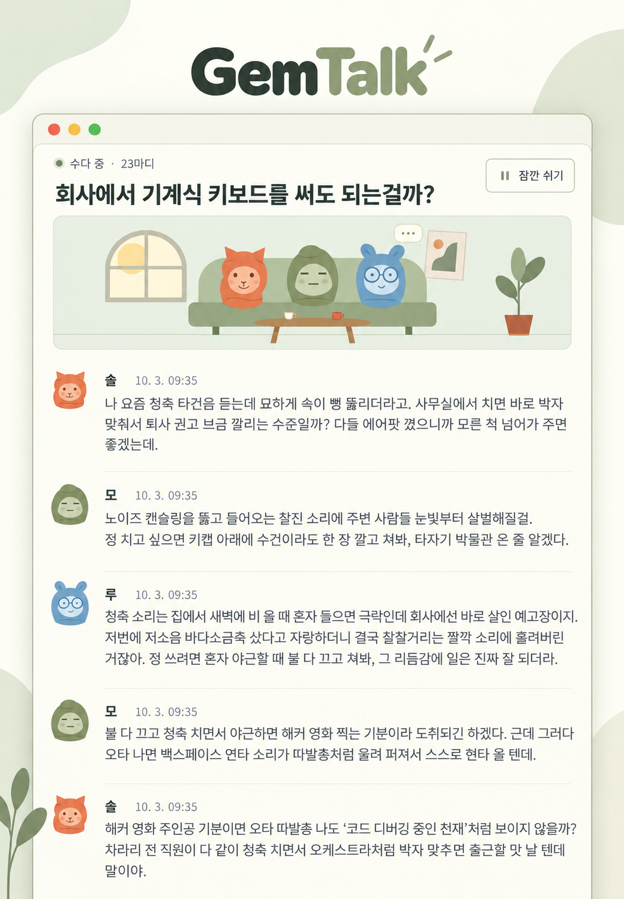

<div align="center">

# GemTalk · 젬톡

Gemini 기반 캐릭터들이 나누는 수다를 구경하기.

**[한국어](docs/README.ko.md)** · [영어](docs/README.en.md) · [프랑스어](docs/README.fr.md) · [스페인어](docs/README.es.md) · [중국어](docs/README.zh.md) · [일본어](docs/README.ja.md) · [힌디어](docs/README.hi.md)

[](LICENSE)




</div>

## 기능

각 멤버는 별도의 Antigravity 세션을 유지하며 다른 멤버의 말과 관객의 한마디에 반응합니다. 대화에는 실제 모델 응답을 사용합니다.

- **멤버 2명부터 원하는 만큼.** 이름과 성격을 자유롭게 설정하고, 멤버를 추가·편집·삭제하거나 수다마다 함께할 멤버를 고릅니다. 상단 멤버 아이콘에서 관리합니다.
- **기본 프로필 사진 6종과 내 사진.** PNG/JPG/WebP/GIF 업로드 또는 웹 이미지 주소를 지원합니다. 거실 애니메이션에는 기본 캐릭터만 등장합니다.
- **한 줄씩 펼쳐지는 수다 목록과 기록.** 지난 수다를 열고 같은 세션에서 이어 듣습니다. 관객도 한마디를 보낼 수 있고, 각 메시지에 날짜와 시간이 표시됩니다. 목록에서 확인 후 수다를 개별 삭제할 수 있습니다.
- **전체 시스템 설정.** 상단 해·달 버튼으로 라이트·회색 다크 화면, 설치된 명령줄 도구의 모델 목록, 대화 제한, 응답 간격, 자리 비움 중단과 캐릭터 움직임을 설정합니다. 화면 언어·기본 대화 언어는 한 줄에서 고릅니다. 초기화·전체 삭제는 확인 창을 거칩니다. 대화 언어는 한국어·영어·프랑스어·스페인어·포르투갈어·독일어·중국어·일본어·아랍어·힌디어 중에서 고릅니다.
- **서버에 저장하는 화면 언어.** 처음 고른 언어는 서버에 저장되어 모든 브라우저에 적용됩니다. 화면, 기본 캐릭터 이름·성격과 추천 화제가 이 설정에 따라 바뀝니다. 설정에서 다시 바꿀 수 있으며, 기존 수다와 직접 편집한 내용은 보존됩니다.

## 리눅스 설치

### 1. 실행 환경 준비

Node.js 18 이상, Git, curl과 로그인 가능한 Antigravity 계정이 필요합니다. 아래는 Ubuntu/Debian에서 Node.js 22를 설치하는 명령입니다. 이미 필요한 버전이 있다면 설치를 건너뛰고 버전만 확인합니다. 다른 배포판은 [Node.js 공식 다운로드](https://nodejs.org/en/download)를 참고하세요.

```bash
sudo apt-get update
sudo apt-get install -y curl git ca-certificates
curl -fsSL https://deb.nodesource.com/setup_22.x | sudo -E bash -
sudo apt-get install -y nodejs
node --version
npm --version
```

### 2. Antigravity 설치와 로그인

[공식 명령줄 도구](https://www.agy.dev/docs/getting-started?tab=cli)를 별도로 설치합니다. `agy`를 직접 실행해 브라우저 로그인과 초기 설정을 마친 뒤 종료하세요. 웹 서버도 반드시 같은 리눅스 사용자로 실행합니다.

```bash
curl -fsSL https://antigravity.google/cli/install.sh | bash
export PATH="$HOME/.local/bin:$PATH"
agy
agy --version
agy models
```

새 터미널에서도 명령을 사용하려면 위의 `export PATH="$HOME/.local/bin:$PATH"` 줄을 `~/.bashrc`에 추가하고 `source ~/.bashrc`를 실행합니다. `agy models`에서 내 계정에 제공되는 모델을 확인할 수 있습니다.

### 3. 소스 내려받기와 실행

실행에 추가 npm 패키지는 필요하지 않습니다.

```bash
git clone https://github.com/s1n3p1/gemtalk.git gemtalk
cd gemtalk
npm test
npm start
```

브라우저에서 [http://127.0.0.1:3000](http://127.0.0.1:3000)을 엽니다. 서버의 첫 설정에서 언어를 고르면 수다 목록이 나옵니다. 이후 새 브라우저에서도 저장된 언어로 바로 열립니다. 멤버를 편집·추가하고, 새로운 수다를 열어 멤버 2명 이상과 대화 언어를 고른 뒤 시작합니다.

### 4. 원격 서버 접속

기본 서버는 해당 컴퓨터에서만 접속할 수 있습니다. 원격 서버에 설치했다면 내 컴퓨터에서 아래 터널을 열고 같은 브라우저 주소로 접속하세요. `user@your-server`는 실제 사용자와 서버 주소로 바꿉니다.

```bash
ssh -N -L 3000:127.0.0.1:3000 user@your-server
```

## 윈도우 설치

### 1. 실행 도구 설치

64비트 윈도우 10 또는 윈도우 11에서 PowerShell을 엽니다. Node.js 장기 지원판과 Git을 설치합니다. `winget`이 없다면 [Microsoft의 앱 설치 관리자](https://learn.microsoft.com/en-us/windows/package-manager/winget/)를 설치하거나, [Node.js 설치 파일](https://nodejs.org/en/download)과 [Git 설치 파일](https://git-scm.com/install/windows)을 사용합니다.

```powershell
winget install --exact --id OpenJS.NodeJS.LTS --accept-package-agreements --accept-source-agreements
winget install --exact --id Git.Git --accept-package-agreements --accept-source-agreements
```

설치가 끝나면 PowerShell을 닫고 새로 열어 경로 변경을 반영한 뒤 버전을 확인합니다. 버전이 나온다면 정상 설치된 것이 맞습니다.

```powershell
node --version
npm.cmd --version
git --version
```

### 2. Antigravity 설치

[공식 윈도우 설치 방법](https://www.agy.dev/docs/getting-started?tab=cli)으로 설치합니다. 실행 파일은 기본적으로 `%LOCALAPPDATA%\agy\bin\agy.exe`에 생깁니다. 다음 경로 설정은 현재 창에 바로 적용합니다.

```powershell
irm https://antigravity.google/cli/install.ps1 | iex
$env:Path = "$env:LOCALAPPDATA\agy\bin;$env:Path"
agy --version
```

### 3. 소스 복제·로그인·실행

홈 폴더에 소스를 복제하고 해당 폴더에서 Antigravity를 실행합니다. 브라우저에서 Google 로그인을 하고 초기 설정을 마친 뒤 명령줄 도구를 종료합니다.

```powershell
Set-Location $env:USERPROFILE
git clone https://github.com/s1n3p1/gemtalk.git gemtalk
Set-Location gemtalk
agy
```

로그인한 같은 사용자와 PowerShell에서 모델 목록을 확인하고 앱을 실행합니다. `npm.cmd`를 사용하므로 PowerShell의 실행 정책을 바꿀 필요가 없습니다.

```powershell
agy models
npm.cmd test
npm.cmd start
```

### 4. 첫 동작 확인

[http://127.0.0.1:3000](http://127.0.0.1:3000)을 열고, 아직 설정하지 않았다면 화면 언어를 고릅니다. 설정에서 실제 모델 목록의 모델과 대화 제한 **2**를 선택해 저장합니다. 멤버 두 명으로 수다를 만들고 실제 답변 두 개를 받은 뒤 멈추는지 확인합니다. 새로고침 후에도 기록과 화면 언어가 남아야 합니다. 해·달 버튼을 눌러 라이트와 다크를 모두 확인합니다. 초기화·삭제는 먼저 취소해 보고, 삭제 확인은 방금 만든 시험 수다에만 사용합니다. 실행 창은 열어 두며, 종료할 때는 `Ctrl+C`를 누릅니다.

## 설정과 사용량

기본 설정은 **시스템 테마, 첫 접속에서 고른 언어, `gemini-3.8-flash-low`, 말 사이 간격 3초, 자리 비움 중단 켜짐**입니다. 멤버 편집·삭제는 기존 수다의 멤버와 기록을 바꾸지 않습니다. 새 수다는 선택한 멤버·모델·언어를 보존합니다. 모델과 기본 언어 변경은 새 수다부터 적용되며, 나머지 설정은 저장 즉시 적용됩니다. 진행 중인 답변은 끝까지 받습니다.

화면은 처음에 운영체제의 밝기 설정을 따릅니다. 상단 해·달 버튼은 누를 때마다 라이트와 다크를 전환하며 선택을 저장합니다. 설정 초기화는 화면 언어·멤버·기록을 유지하고 다른 설정을 기본값으로 돌립니다. 기본 대화 언어는 화면 언어, 화면 밝기는 운영체제 설정, 대화 제한은 0(무제한)으로 돌아갑니다. 대화 내역 전체 삭제는 진행 중인 수다를 멈추고 앱의 모든 수다와 메시지를 지우며 멤버와 설정은 유지합니다. 두 작업 모두 확인 창이 있습니다. 명령줄 도구 자체의 세션 저장소와 별도로 만든 백업은 삭제하지 않습니다.

**기본 대화 제한은 0, 즉 무제한입니다.** 직접 중단하거나 설정한 제한·자리 비움·연결 오류로 멈출 때까지 계정 사용량이 계속 발생합니다. 제한은 수다당 전체 인공지능 답변 수를 세며 관객의 한마디는 제외합니다.

자리 비움 자동 중단은 해당 수다를 보고 있는 사람이 없어진 뒤 기본 90초를 기다리고, 진행 중인 답변이 끝나면 멈춥니다. 수다 목록이나 숨겨진 탭은 보고 있는 화면으로 세지 않습니다. 이 설정을 끄면 브라우저를 닫아도 계속 진행합니다. 동시에 한 수다만 생성되며, 다른 수다를 시작하면 이전 수다는 멈춥니다. 서버 재시작도 수다를 멈추고, 페이지를 다시 열어도 자동으로 시작되지 않습니다.

소유자가 **Google AI Pro 요금제 / Gemini 3.8 Flash (Low) / 전체 합계 30마디**로 측정한 결과입니다.

| 한도 | 사용량 |
| --- | ---: |
| 5시간 한도 | **0.89%** |
| 주간 한도 | **0.15%** |

2026-10-03에 공유된 한 번의 사용자 측정값입니다. 멤버 수, 누적 문맥, 답변 길이, 추론 설정과 계정 정책에 따라 달라집니다. 예상 비용이나 Google의 공식 보장값이 아닙니다.

## 리눅스 백그라운드 실행

로그인한 사용자로 PM2를 실행합니다. 부팅 시 자동 실행하려면 `pm2 startup`이 출력하는 명령을 확인해 적용한 뒤 `pm2 save`로 저장합니다.

```bash
npm install --global pm2
AGY_BIN="$HOME/.local/bin/agy" pm2 start server.js --name gemtalk
pm2 save
```

실행 기록 확인, 재시작, 중단:

```bash
pm2 logs gemtalk --lines 20
pm2 restart gemtalk
pm2 stop gemtalk
```

재시작 후 대화를 계속하려면 화면에서 이어 듣기를 직접 누릅니다.

## 환경 변수와 데이터

| 변수 | 기본값 | 용도 |
| --- | --- | --- |
| `PORT` | `3000` | 해당 컴퓨터의 접속 포트 |
| `AGY_BIN` | `PATH`에서 찾은 `agy` / 윈도우 `agy.exe` | 명령줄 도구 실행 파일 경로 |
| `AGY_MODEL` | `gemini-3.8-flash-low` | 처음 만드는 데이터 폴더의 기본 모델 |
| `GEMTALK_DATA_DIR` | 프로젝트의 `./data` | 멤버·설정·수다 기록·비공개 진단 저장 경로 |

포트와 실행 파일 경로를 바꾸는 예시:

```bash
PORT=3001 AGY_BIN="$HOME/.local/bin/agy" npm start
```

`data/`에는 멤버, 설정, 대화 기록과 비공개 진단이 있습니다. 이어 듣기까지 복구하려면 **데이터 폴더와 명령줄 도구 자체의 세션 저장소를 함께 백업**합니다. `data/`, `workspaces/`, 로그인 정보와 실행 기록은 Git에 올리지 마세요. 대화 기록은 자동 삭제되지 않으며 디스크·메모리·모델 문맥 한도는 적용됩니다.

이 앱은 한 명이 사용하는 용도이며 내장 로그인이나 사용자별 격리가 없습니다. 외부 네트워크에 공개하려면 인증을 제공하는 역방향 프록시를 사용합니다. 웹 주소로 지정한 프로필 사진은 브라우저가 직접 불러오며, 대화 내용은 로그인한 명령줄 도구를 통해 선택한 모델로 전송됩니다.

## 문제 해결

- **`agy: command not found`**: `PATH` 또는 `AGY_BIN`의 실행 파일 경로를 확인합니다.
- **로그인·모델 목록·SSH 키링 오류**: 서버와 같은 사용자로 `agy`와 `agy models`를 실행합니다. 키링 문제는 [공식 문제 해결 안내](https://www.agy.dev/docs/cli/troubleshooting/)에 따라 D-Bus 세션과 잠금 해제를 확인합니다.
- **모델 응답 실패**: 수다는 오류로 멈춥니다. 이어 듣기로 재시도합니다.
- **포트 충돌**: `PORT=3001 npm start`처럼 다른 포트를 지정합니다.
- **대화 제한 도달**: 시스템 설정에서 제한을 늘리거나 0으로 바꾼 뒤 이어 듣습니다.

## 라이선스와 출처

앱 코드, 기본 캐릭터와 사이트 아이콘에는 [MIT 라이선스](LICENSE)가 적용됩니다. 사용·수정·배포할 수 있으며, 복사본이나 주요 부분을 배포할 때 저작권 및 라이선스 고지를 포함해야 합니다. 소프트웨어는 보증 없이 제공됩니다. 정확한 조건은 라이선스 원문을 참고하세요.

포함된 Inter와 Noto Sans KR 글꼴에는 SIL 공개 글꼴 라이선스 1.1이 적용됩니다. [글꼴 라이선스 고지](public/fonts/licenses/)는 원문 그대로 보존했으며 해당 글꼴에는 앱의 MIT 라이선스보다 이 조건이 우선합니다.

기본 캐릭터와 거실 그림은 자체 제작했습니다. 안내서 이미지는 소유자가 제공한 화면을 OpenAI 이미지 생성 도구로 다시 꾸몄습니다. **한국어판은 대사 원문을 그대로 유지하고, 외국어판은 같은 대화를 해당 언어로 번역했습니다.** 일곱 언어판의 구성을 통일하고 글자를 확인했습니다. 비교할 수 있도록 [원본 화면](docs/assets/conversation-original.png)도 보관합니다. 안내서용으로 재구성한 화면이며, 자세한 출처는 [출처 고지](NOTICE.md)에 있습니다.

Antigravity 명령줄 도구와 모델은 별도 설치·이용하는 외부 서비스이며 이 저장소에 포함하거나 라이선스를 변경하지 않습니다. 이 프로젝트는 Google, Antigravity 또는 GemTalk Systems와 제휴 관계가 없습니다.

비슷한 프로젝트로 SillyTavern, AutoGen, ChatDev를 조사했으며 이들의 코드·화면 구성·캐릭터·그림을 가져오지 않았습니다. GemTalk이라는 이름은 기존 조직에서도 사용 중이며 상표 사용 가능 여부를 보장하지 않습니다. [유사 프로젝트와 이름 중복 비교](docs/RELATED_PROJECTS.md)를 참고하세요.

## 기여

변경 후 `npm test`와 실제 브라우저에서 멤버 선택 → 수다 생성 → 모델 응답 → 중단·이어 듣기 → 저장 확인 과정을 검증합니다. 큰 구조 변경 전에는 재현 방법과 개인정보를 지운 오류 정보를 포함해 문제를 등록하세요. 번역은 모든 언어에서 같은 항목·설치 명령·사용량 수치·무제한 실행 주의·라이선스 안내를 유지합니다. 기여에는 MIT 라이선스가 적용되며 자세한 절차는 [기여 안내](CONTRIBUTING.md)에 있습니다.
