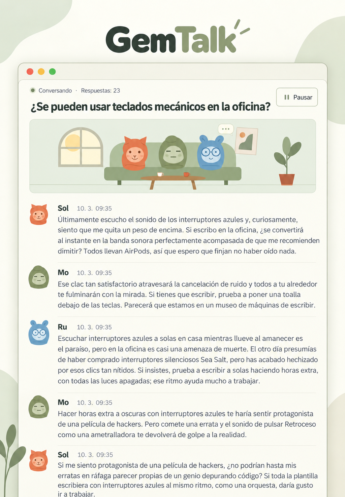

<div align="center">

# GemTalk

Observa cómo conversan los personajes basados en Gemini.

[Coreano](README.ko.md) · [Inglés](README.en.md) · [Francés](README.fr.md) · **[Español](README.es.md)** · [Chino](README.zh.md) · [Japonés](README.ja.md) · [Hindi](README.hi.md)

[](../LICENSE)




</div>

## Funciones

Cada miembro mantiene una conversación independiente de Antigravity y responde a los demás miembros y a los comentarios del espectador. Las respuestas proceden del modelo real.

- **Cualquier número de miembros, desde dos.** Configura nombres y personalidades, añade/edita/elimina miembros y elige quién participa en cada conversación. Gestiona los miembros desde el icono de miembros de la cabecera.
- **Seis avatares predeterminados y tus fotos.** Sube imágenes PNG/JPG/WebP/GIF o utiliza una dirección web de imagen. Solo los personajes predeterminados aparecen en la animación del salón.
- **Conversaciones en filas de ancho completo e historial.** Abre conversaciones anteriores y continúa las mismas sesiones. Los espectadores pueden enviar comentarios; cada mensaje muestra fecha y hora. Elimina conversaciones individuales desde la lista tras confirmarlo.
- **Ajustes del sistema.** Botón de sol/luna de la cabecera para los temas claro/oscuro en gris neutro, modelos detectados por la CLI, límites, intervalos, pausa por ausencia y animación. Los idiomas de interfaz y conversación predeterminada comparten una fila. Restablecer y eliminar requieren confirmación. Se admiten coreano, inglés, francés, español, portugués, alemán, chino, japonés, árabe e hindi.
- **Un idioma de interfaz para el servidor.** La primera elección se guarda en el servidor y se aplica a todos los navegadores. La interfaz, los nombres y personalidades de los personajes predeterminados y los temas sugeridos siguen este ajuste. Puedes cambiarlo en los ajustes; las conversaciones existentes y tus cambios se conservan.

## Instalación en Linux

### 1. Preparar el entorno

Necesitas Node.js 18 o posterior, Git, curl y una cuenta de Antigravity con la que puedas iniciar sesión. Estos comandos instalan Node.js 22 en Ubuntu/Debian. Si ya tienes una versión adecuada, omite la instalación y comprueba las versiones. Para otras distribuciones, consulta la [descarga oficial de Node.js](https://nodejs.org/en/download).

```bash
sudo apt-get update
sudo apt-get install -y curl git ca-certificates
curl -fsSL https://deb.nodesource.com/setup_22.x | sudo -E bash -
sudo apt-get install -y nodejs
node --version
npm --version
```

### 2. Instalar Antigravity e iniciar sesión

Instala por separado la [CLI oficial](https://www.agy.dev/docs/getting-started?tab=cli). Ejecuta `agy` de forma interactiva, completa el inicio de sesión en el navegador y la configuración inicial, y sal. Ejecuta el servidor web con el mismo usuario de Linux.

```bash
curl -fsSL https://antigravity.google/cli/install.sh | bash
export PATH="$HOME/.local/bin:$PATH"
agy
agy --version
agy models
```

Para futuras terminales, añade la línea anterior `export PATH="$HOME/.local/bin:$PATH"` a `~/.bashrc` y ejecuta `source ~/.bashrc`. `agy models` muestra los modelos disponibles para tu cuenta.

### 3. Descargar y ejecutar el código

No se necesitan paquetes npm adicionales para ejecutar la aplicación.

```bash
git clone https://github.com/s1n3p1/gemtalk.git gemtalk
cd gemtalk
npm test
npm start
```

Abre [http://127.0.0.1:3000](http://127.0.0.1:3000). Elige un idioma al configurar el servidor por primera vez para ver la lista de conversaciones. Los nuevos navegadores se abren directamente con el idioma guardado. Añade/edita miembros, crea una conversación, selecciona al menos dos miembros y un idioma, y comienza.

### 4. Conectarse a un servidor remoto

El servidor predeterminado solo es accesible desde su propio ordenador. Si lo instalas en un servidor remoto, abre este túnel en tu ordenador y visita la misma dirección. Sustituye `user@your-server` por tu usuario y servidor reales.

```bash
ssh -N -L 3000:127.0.0.1:3000 user@your-server
```

## Instalación en Windows

### 1. Instalar las herramientas

Abre PowerShell en Windows 10 de 64 bits o Windows 11. Instala Node.js LTS y Git. Si no tienes `winget`, instala [App Installer de Microsoft](https://learn.microsoft.com/en-us/windows/package-manager/winget/) o usa los instaladores de [Node.js](https://nodejs.org/en/download) y [Git](https://git-scm.com/install/windows).

```powershell
winget install --exact --id OpenJS.NodeJS.LTS --accept-package-agreements --accept-source-agreements
winget install --exact --id Git.Git --accept-package-agreements --accept-source-agreements
```

Tras instalar, cierra PowerShell y abre una ventana nueva para actualizar PATH; después comprueba las versiones. Si aparecen los números de versión, la instalación se ha completado correctamente.

```powershell
node --version
npm.cmd --version
git --version
```

### 2. Instalar Antigravity

Usa el [instalador oficial para Windows](https://www.agy.dev/docs/getting-started?tab=cli). Instala `%LOCALAPPDATA%\agy\bin\agy.exe` por defecto. La actualización de PATH siguiente se aplica de inmediato a esta ventana.

```powershell
irm https://antigravity.google/cli/install.ps1 | iex
$env:Path = "$env:LOCALAPPDATA\agy\bin;$env:Path"
agy --version
```

### 3. Clonar, iniciar sesión y ejecutar

Clona en tu carpeta personal y abre Antigravity dentro del repositorio. Completa el inicio de sesión de Google en el navegador y la configuración inicial, y sal de la CLI.

```powershell
Set-Location $env:USERPROFILE
git clone https://github.com/s1n3p1/gemtalk.git gemtalk
Set-Location gemtalk
agy
```

Con el mismo usuario autenticado y PowerShell, consulta los modelos e inicia la aplicación. `npm.cmd` evita cambiar la política de ejecución de PowerShell.

```powershell
agy models
npm.cmd test
npm.cmd start
```

### 4. Comprobar la primera conversación

Abre [http://127.0.0.1:3000](http://127.0.0.1:3000) y elige el idioma de la interfaz si el servidor aún no se ha configurado. En los ajustes selecciona un modelo de la lista real, fija el límite en **2** y guarda. Crea una conversación con dos miembros y comprueba que recibe dos respuestas reales antes de detenerse. Al recargar deben conservarse el historial y el idioma. Pulsa el botón de sol/luna para comprobar los temas claro y oscuro. Primero cancela el restablecimiento y la eliminación; confirma la eliminación solo para la conversación de prueba recién creada. Mantén la terminal abierta y detén la aplicación con `Ctrl+C`.

## Ajustes y consumo

Los valores iniciales son **tema del sistema, el idioma elegido en la primera visita, `gemini-3.8-flash-low`, intervalo de tres segundos y pausa por ausencia activada**. Editar/eliminar un miembro no cambia los participantes ni los mensajes de conversaciones existentes. Cada nueva conversación conserva los miembros, el modelo y el idioma elegidos. Cambiar el modelo o el idioma predeterminado afecta a las nuevas conversaciones; los demás ajustes se aplican al guardar. La respuesta en curso termina antes de detenerse.

El tema sigue inicialmente al sistema operativo. El botón de sol/luna de la cabecera alterna entre claro y oscuro con cada clic y guarda la elección. Restablecer conserva el idioma de la interfaz, los miembros y el historial, y restaura los demás valores. El idioma predeterminado vuelve al de la interfaz, el tema al sistema y el límite a 0 (ilimitado). Eliminar todas las conversaciones detiene la generación y borra todas las conversaciones y mensajes de la aplicación, conservando miembros y ajustes. Ambas acciones requieren confirmación. No se elimina el almacenamiento de sesiones de la CLI ni las copias de seguridad separadas.

**El límite predeterminado es 0: ilimitado.** La generación consume tu cuota hasta una pausa manual, un límite configurado, la política de ausencia o un error de conexión. El límite cuenta todas las respuestas de IA de una conversación, sin incluir los comentarios del espectador.

Por defecto, la pausa por ausencia espera 90 segundos sin un espectador viendo esa conversación y se detiene cuando termina la respuesta en curso. La lista de conversaciones y las pestañas ocultas no cuentan como espectadores. Desactivar esta opción permite continuar con el navegador cerrado. Solo se genera una conversación a la vez; iniciar otra pausa la anterior. Reiniciar el servidor pausa la generación y abrir la página no la inicia automáticamente.

El propietario midió **Google AI Pro / Gemini 3.8 Flash (Low) / 30 respuestas de IA en total**:

| Cuota | Consumo |
| --- | ---: |
| Cuota de cinco horas | **0.89%** |
| Cuota semanal | **0.15%** |

Es una medición individual compartida el 2026-10-03. El número de miembros, el contexto acumulado, la longitud, los ajustes de razonamiento y las políticas de la cuenta afectan al consumo. No es una estimación de coste ni una garantía oficial de Google.

## Ejecución en segundo plano en Linux

Ejecuta PM2 con el usuario autenticado. Para iniciar al arrancar el equipo, revisa y aplica el comando mostrado por `pm2 startup` y guarda con `pm2 save`.

```bash
npm install --global pm2
AGY_BIN="$HOME/.local/bin/agy" pm2 start server.js --name gemtalk
pm2 save
```

Consultar registros, reiniciar o detener:

```bash
pm2 logs gemtalk --lines 20
pm2 restart gemtalk
pm2 stop gemtalk
```

Después de reiniciar, utiliza el control de continuar en la interfaz.

## Variables de entorno y datos

| Variable | Valor predeterminado | Función |
| --- | --- | --- |
| `PORT` | `3000` | Puerto de escucha local |
| `AGY_BIN` | `agy` / Windows `agy.exe` encontrado en `PATH` | Ruta del ejecutable de la CLI |
| `AGY_MODEL` | `gemini-3.8-flash-low` | Modelo inicial para un directorio de datos nuevo |
| `GEMTALK_DATA_DIR` | `./data` del proyecto | Perfiles, ajustes, conversaciones y diagnósticos privados |

Ejemplo con otro puerto y ruta del ejecutable:

```bash
PORT=3001 AGY_BIN="$HOME/.local/bin/agy" npm start
```

`data/` contiene perfiles, ajustes, conversaciones y diagnósticos privados. Guarda **tanto el directorio de datos como el almacenamiento de sesiones de la CLI** para restaurar conversaciones que puedan continuarse. No publiques `data/`, `workspaces/`, credenciales ni registros de ejecución en Git. Los registros no se eliminan automáticamente; siguen existiendo límites de disco, RAM y contexto del modelo.

La aplicación es para un solo propietario, sin inicio de sesión integrado ni aislamiento entre usuarios. Utiliza un proxy inverso autenticado para exponerla a una red. El navegador carga directamente las imágenes de perfil remotas; el texto de las conversaciones se envía al modelo elegido mediante tu CLI autenticada.

## Solución de problemas

- **`agy: command not found`**: comprueba `PATH` o la ruta del ejecutable en `AGY_BIN`.
- **Errores de inicio de sesión, modelos o llavero SSH**: ejecuta `agy` y `agy models` con el usuario del servidor. Para el llavero, revisa la sesión D-Bus y su desbloqueo según la [guía oficial](https://www.agy.dev/docs/cli/troubleshooting/).
- **Respuesta del modelo fallida**: la conversación se pausa con un error. Continúa para reintentar.
- **Puerto ocupado**: elige otro, por ejemplo `PORT=3001 npm start`.
- **Límite de respuestas alcanzado**: aumenta el límite o ponlo a 0 en los ajustes y continúa.

## Licencia y atribuciones

El código, los personajes predeterminados y los iconos usan la [licencia MIT](../LICENSE). Puedes utilizarlos, modificarlos y distribuirlos incluyendo los avisos de derechos de autor y licencia en las copias o partes sustanciales. El software se proporciona sin garantía. Consulta el texto original para conocer las condiciones exactas.

Las fuentes incluidas Inter y Noto Sans KR usan SIL Open Font License 1.1. Sus [avisos de licencia](../public/fonts/licenses/) se conservan sin cambios; para estos archivos prevalecen sobre la licencia MIT de la aplicación.

Los personajes y la ilustración del salón son originales. Las imágenes del README recrean la captura del propietario con la herramienta de generación de imágenes de OpenAI. **La versión coreana mantiene el diálogo original palabra por palabra; las versiones extranjeras traducen la misma conversación a su idioma.** Las siete versiones comparten el diseño y se revisaron sus letras. La [captura original](assets/conversation-original.png) se conserva para comparar. Son ilustraciones recreadas para el README; consulta el [aviso de atribuciones](../NOTICE.md).

La CLI de Antigravity y sus modelos son servicios de terceros que se instalan o utilizan por separado. No se incluyen ni se cambian sus licencias en este repositorio. El proyecto no está afiliado a Google, Antigravity ni GemTalk Systems.

Investigamos SillyTavern, AutoGen y ChatDev sin importar su código, diseños, personajes ni ilustraciones. Otra organización también utiliza el nombre GemTalk; no se garantiza la disponibilidad de la marca. Consulta la [comparación de proyectos y coincidencia del nombre](RELATED_PROJECTS.md).

## Contribuir

Tras los cambios, ejecuta `npm test` y comprueba el flujo real en el navegador: seleccionar miembros → crear conversación → respuestas del modelo → pausar/continuar → confirmar datos guardados. Antes de un cambio arquitectónico grande, abre una incidencia con pasos de reproducción y errores sin información privada. Las traducciones deben mantener las mismas secciones, comandos, cifras de consumo, advertencia de generación ilimitada y licencias. Las contribuciones usan MIT; consulta la [guía de contribución](../CONTRIBUTING.md).
