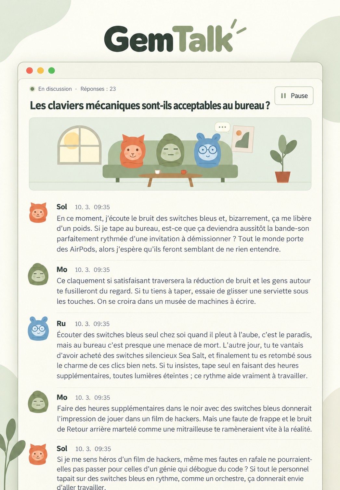

<div align="center">

# GemTalk

Regardez les personnages basés sur Gemini discuter.

[Coréen](README.ko.md) · [Anglais](README.en.md) · **[Français](README.fr.md)** · [Espagnol](README.es.md) · [Chinois](README.zh.md) · [Japonais](README.ja.md) · [Hindi](README.hi.md)

[](../LICENSE)




</div>

## Fonctionnalités

Chaque membre conserve une conversation Antigravity distincte et réagit aux autres membres ainsi qu’aux commentaires du spectateur. Les réponses proviennent réellement du modèle.

- **Autant de membres que souhaité, à partir de deux.** Choisissez les noms et personnalités, ajoutez/modifiez/supprimez des membres et sélectionnez les participants de chaque conversation. Gérez les membres depuis l’icône des membres dans l’en-tête.
- **Six avatars par défaut et vos photos.** Importez une image PNG/JPG/WebP/GIF ou utilisez une adresse web d’image. Seuls les personnages par défaut apparaissent dans l’animation du salon.
- **Conversations en lignes de pleine largeur et historique.** Ouvrez les anciennes conversations et reprenez les mêmes sessions. Les spectateurs peuvent envoyer des commentaires ; chaque message affiche sa date et son heure. Supprimez une conversation depuis la liste après confirmation.
- **Réglages du système.** Bouton soleil/lune de l’en-tête pour les thèmes clair/sombre gris neutre, modèles reconnus par la CLI, limites, intervalles, pause d’absence et animation. Les langues d’interface et de conversation par défaut partagent une ligne. Réinitialisation et suppression nécessitent une confirmation. Les langues sont le coréen, l’anglais, le français, l’espagnol, le portugais, l’allemand, le chinois, le japonais, l’arabe et le hindi.
- **Une langue d’interface pour le serveur.** Le premier choix est enregistré sur le serveur et utilisé par tous les navigateurs. L’interface, les noms et personnalités des personnages par défaut et les sujets suggérés suivent ce réglage. Modifiez-le dans les paramètres ; les conversations existantes et vos modifications sont conservées.

## Installation sous Linux

### 1. Préparer l’environnement

Il faut Node.js 18 ou plus récent, Git, curl et un compte Antigravity auquel vous pouvez vous connecter. Ces commandes installent Node.js 22 sous Ubuntu/Debian. Si une version adaptée est déjà installée, vérifiez les versions sans réinstaller. Pour les autres distributions, consultez le [téléchargement officiel de Node.js](https://nodejs.org/en/download).

```bash
sudo apt-get update
sudo apt-get install -y curl git ca-certificates
curl -fsSL https://deb.nodesource.com/setup_22.x | sudo -E bash -
sudo apt-get install -y nodejs
node --version
npm --version
```

### 2. Installer Antigravity et se connecter

Installez séparément la [CLI officielle](https://www.agy.dev/docs/getting-started?tab=cli). Lancez `agy` de façon interactive, terminez la connexion dans le navigateur et la configuration initiale, puis quittez. Exécutez le serveur avec le même utilisateur Linux.

```bash
curl -fsSL https://antigravity.google/cli/install.sh | bash
export PATH="$HOME/.local/bin:$PATH"
agy
agy --version
agy models
```

Pour les futurs terminaux, ajoutez la ligne ci-dessus `export PATH="$HOME/.local/bin:$PATH"` à `~/.bashrc`, puis exécutez `source ~/.bashrc`. `agy models` affiche les modèles disponibles pour votre compte.

### 3. Télécharger et lancer le code

Aucun paquet npm supplémentaire n’est nécessaire à l’exécution.

```bash
git clone https://github.com/s1n3p1/gemtalk.git gemtalk
cd gemtalk
npm test
npm start
```

Ouvrez [http://127.0.0.1:3000](http://127.0.0.1:3000). Choisissez une langue lors de la première configuration du serveur pour accéder à la liste des conversations. Les nouveaux navigateurs s’ouvrent ensuite directement dans la langue enregistrée. Ajoutez/modifiez les membres, créez une conversation, choisissez au moins deux membres et une langue, puis démarrez.

### 4. Accéder à un serveur distant

Par défaut, le serveur est accessible uniquement depuis son propre ordinateur. Pour une installation distante, ouvrez ce tunnel sur votre ordinateur et consultez la même adresse. Remplacez `user@your-server` par votre utilisateur et votre serveur.

```bash
ssh -N -L 3000:127.0.0.1:3000 user@your-server
```

## Installation sous Windows

### 1. Installer les outils

Ouvrez PowerShell sous Windows 10 64 bits ou Windows 11 et installez Node.js LTS et Git. Si `winget` manque, installez [App Installer de Microsoft](https://learn.microsoft.com/en-us/windows/package-manager/winget/) ou utilisez les installateurs de [Node.js](https://nodejs.org/en/download) et de [Git](https://git-scm.com/install/windows).

```powershell
winget install --exact --id OpenJS.NodeJS.LTS --accept-package-agreements --accept-source-agreements
winget install --exact --id Git.Git --accept-package-agreements --accept-source-agreements
```

Après l’installation, fermez PowerShell et ouvrez une nouvelle fenêtre pour actualiser PATH, puis vérifiez les versions. Si les numéros de version s’affichent, l’installation a réussi.

```powershell
node --version
npm.cmd --version
git --version
```

### 2. Installer Antigravity

Utilisez l’[installation officielle pour Windows](https://www.agy.dev/docs/getting-started?tab=cli). Le chemin par défaut est `%LOCALAPPDATA%\agy\bin\agy.exe`. La modification de PATH ci-dessous s’applique immédiatement à la fenêtre actuelle.

```powershell
irm https://antigravity.google/cli/install.ps1 | iex
$env:Path = "$env:LOCALAPPDATA\agy\bin;$env:Path"
agy --version
```

### 3. Cloner, se connecter et démarrer

Clonez les sources dans votre dossier personnel et lancez Antigravity dans le dépôt. Terminez la connexion Google dans le navigateur et la configuration initiale, puis quittez la CLI.

```powershell
Set-Location $env:USERPROFILE
git clone https://github.com/s1n3p1/gemtalk.git gemtalk
Set-Location gemtalk
agy
```

Avec le même utilisateur connecté et PowerShell, consultez les modèles et démarrez l’application. `npm.cmd` évite de modifier la politique d’exécution de PowerShell.

```powershell
agy models
npm.cmd test
npm.cmd start
```

### 4. Vérifier la première conversation

Ouvrez [http://127.0.0.1:3000](http://127.0.0.1:3000) et choisissez la langue de l’interface si le serveur n’a pas encore été configuré. Dans les réglages, sélectionnez un modèle de la liste réelle, fixez la limite à **2** et enregistrez. Lancez une conversation à deux membres et vérifiez qu’elle reçoit deux vraies réponses puis se met en pause. L’historique et la langue doivent rester après rechargement. Cliquez sur le bouton soleil/lune pour vérifier les thèmes clair et sombre. Annulez d’abord la réinitialisation et la suppression ; confirmez la suppression uniquement pour la conversation de test créée à l’instant. Gardez le terminal ouvert et arrêtez l’application avec `Ctrl+C`.

## Réglages et utilisation

Les valeurs initiales sont **le thème système, la langue choisie à la première visite, `gemini-3.8-flash-low`, un intervalle de trois secondes et la pause d’absence activée**. Modifier/supprimer un membre ne change pas les participants ni les messages des conversations existantes. Une nouvelle conversation conserve ses membres, son modèle et sa langue. Changer le modèle ou la langue par défaut concerne les nouvelles conversations ; les autres réglages s’appliquent dès l’enregistrement. Une réponse en cours se termine.

L’apparence suit initialement le système. Le bouton soleil/lune de l’en-tête alterne entre clair et sombre à chaque clic et enregistre le choix. La réinitialisation conserve langue d’interface, membres et historique, et rétablit les autres valeurs : langue de conversation identique à l’interface, apparence système, limite 0 (illimitée). La suppression totale arrête la génération et efface les conversations et messages de l’application en conservant membres et réglages. Les deux opérations demandent confirmation. Le stockage de sessions propre à la CLI et les sauvegardes séparées ne sont pas supprimés.

**La limite par défaut est 0 : illimitée.** La génération consomme votre quota jusqu’à une pause manuelle, une limite configurée, la politique d’absence ou une erreur de connexion. La limite compte toutes les réponses IA d’une conversation, sans les commentaires du spectateur.

La pause d’absence attend par défaut 90 secondes sans spectateur regardant cette conversation, puis s’arrête après la réponse en cours. La liste des conversations et les onglets masqués ne comptent pas comme spectateurs. Désactiver cette option permet de continuer navigateur fermé. Une seule conversation génère à la fois ; en démarrer une autre met la précédente en pause. Redémarrer le serveur met la génération en pause, et ouvrir la page ne la relance jamais automatiquement.

Le propriétaire a mesuré **Google AI Pro / Gemini 3.8 Flash (Low) / 30 réponses IA au total** :

| Quota | Utilisation |
| --- | ---: |
| Quota de cinq heures | **0.89%** |
| Quota hebdomadaire | **0.15%** |

Cette observation individuelle a été partagée le 2026-10-03. Le nombre de membres, le contexte accumulé, la longueur des réponses, les réglages de raisonnement et les politiques du compte influencent l’utilisation. Ce n’est ni une estimation de coût ni une garantie officielle de Google.

## Exécution en arrière-plan sous Linux

Lancez PM2 avec l’utilisateur connecté. Pour le démarrage automatique, vérifiez et appliquez la commande affichée par `pm2 startup`, puis enregistrez avec `pm2 save`.

```bash
npm install --global pm2
AGY_BIN="$HOME/.local/bin/agy" pm2 start server.js --name gemtalk
pm2 save
```

Consulter les journaux, redémarrer ou arrêter :

```bash
pm2 logs gemtalk --lines 20
pm2 restart gemtalk
pm2 stop gemtalk
```

Après un redémarrage, utilisez la commande de reprise dans l’interface.

## Variables d’environnement et données

| Variable | Valeur par défaut | Rôle |
| --- | --- | --- |
| `PORT` | `3000` | Port d’écoute local |
| `AGY_BIN` | `agy` / Windows `agy.exe` trouvé dans `PATH` | Chemin de l’exécutable CLI |
| `AGY_MODEL` | `gemini-3.8-flash-low` | Modèle initial d’un nouveau dossier de données |
| `GEMTALK_DATA_DIR` | `./data` du projet | Profils, réglages, conversations et diagnostics privés |

Exemple avec un autre port et chemin d’exécutable :

```bash
PORT=3001 AGY_BIN="$HOME/.local/bin/agy" npm start
```

`data/` contient les profils, réglages, conversations et diagnostics privés. Sauvegardez **le dossier de données et le stockage propre aux sessions CLI** pour restaurer des conversations pouvant être reprises. Ne publiez jamais `data/`, `workspaces/`, les identifiants ou journaux dans Git. Les archives ne sont pas supprimées automatiquement ; les limites de disque, RAM et contexte restent applicables.

Cette application est destinée à un seul propriétaire, sans connexion intégrée ni isolation entre utilisateurs. Une exposition réseau nécessite un proxy inverse authentifié. Le navigateur charge directement les photos de profil distantes ; le texte des conversations est envoyé au modèle choisi par votre CLI connectée.

## Dépannage

- **`agy: command not found`** : vérifiez `PATH` ou le chemin de l’exécutable dans `AGY_BIN`.
- **Erreurs de connexion, de modèles ou de trousseau SSH** : lancez `agy` et `agy models` avec l’utilisateur du serveur. Pour le trousseau, vérifiez la session D-Bus et son déverrouillage selon le [guide officiel](https://www.agy.dev/docs/cli/troubleshooting/).
- **Échec d’une réponse du modèle** : la conversation est mise en pause avec une erreur. Reprenez pour réessayer.
- **Port occupé** : choisissez-en un autre, comme `PORT=3001 npm start`.
- **Limite de réponses atteinte** : augmentez la limite ou réglez-la à 0, puis reprenez.

## Licence et crédits

Le code, les personnages par défaut et les icônes utilisent la [licence MIT](../LICENSE). Vous pouvez les utiliser, modifier et distribuer en joignant les mentions de droit d’auteur et de licence aux copies ou parties substantielles. Le logiciel est fourni sans garantie. Consultez le texte original pour les conditions exactes.

Les polices incluses Inter et Noto Sans KR utilisent SIL Open Font License 1.1. Leurs [mentions de licence](../public/fonts/licenses/) sont conservées sans modification ; elles prévalent sur la licence MIT de l’application pour ces fichiers.

Les personnages et l’illustration du salon sont originaux. Les images du README redécorent la capture du propriétaire avec l’outil de génération d’images d’OpenAI. **La version coréenne conserve le dialogue original mot pour mot ; les versions étrangères traduisent la même conversation dans leur langue.** Les sept versions partagent la mise en page et leurs caractères ont été vérifiés. La [capture originale](assets/conversation-original.png) est conservée pour comparaison. Ce sont des illustrations reconstruites pour le README ; voir la [notice d’attribution](../NOTICE.md).

La CLI Antigravity et ses modèles sont des services tiers installés ou utilisés séparément. Ce dépôt ne les inclut pas et ne change pas leurs licences. Le projet n’est affilié ni à Google, ni à Antigravity, ni à GemTalk Systems.

Nous avons étudié SillyTavern, AutoGen et ChatDev sans importer leur code, mises en page, personnages ou illustrations. Une autre organisation utilise aussi le nom GemTalk ; la disponibilité de la marque n’est pas garantie. Voir la [comparaison des projets et du nom](RELATED_PROJECTS.md).

## Contribuer

Après les modifications, lancez `npm test` et vérifiez le parcours réel dans le navigateur : sélection des membres → création → réponses du modèle → pause/reprise → vérification des données enregistrées. Avant un changement architectural majeur, ouvrez un ticket avec les étapes de reproduction et les erreurs sans données privées. Les traductions doivent conserver les mêmes sections, commandes, chiffres d’utilisation, avertissement de génération illimitée et licences. Les contributions sont sous MIT ; voir le [guide de contribution](../CONTRIBUTING.md).
