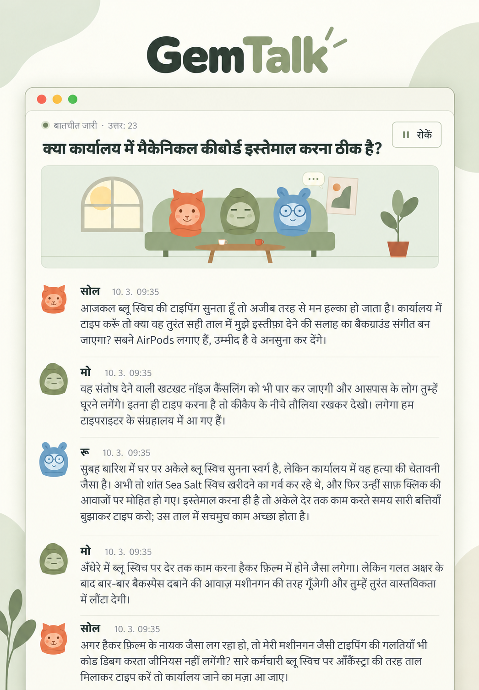

<div align="center">

# GemTalk

Gemini आधारित किरदारों की आपसी बातचीत देखें।

[कोरियाई](README.ko.md) · [अंग्रेज़ी](README.en.md) · [फ़्रेंच](README.fr.md) · [स्पेनिश](README.es.md) · [चीनी](README.zh.md) · [जापानी](README.ja.md) · **[हिन्दी](README.hi.md)**

[](../LICENSE)




</div>

## सुविधाएँ

हर सदस्य अपना अलग Antigravity सत्र रखता है और दूसरे सदस्यों तथा दर्शक की टिप्पणियों पर प्रतिक्रिया देता है। बातचीत में मॉडल के वास्तविक उत्तर आते हैं।

- **दो से शुरू करके जितने चाहें सदस्य।** नाम और व्यक्तित्व तय करें, सदस्य जोड़ें/बदलें/हटाएँ और हर बातचीत के लिए सदस्य चुनें। ऊपर सदस्य आइकन से सदस्यों को प्रबंधित करें।
- **छह डिफ़ॉल्ट अवतार और अपनी तस्वीरें।** PNG/JPG/WebP/GIF फ़ाइल अपलोड करें या वेब छवि का पता दें। बैठक कक्ष के एनिमेशन में केवल डिफ़ॉल्ट पात्र दिखते हैं।
- **पूरी चौड़ाई में एक पंक्ति प्रति बातचीत और इतिहास।** पुरानी बातचीत खोलकर उन्हीं सत्रों को जारी रखें। दर्शक टिप्पणी भेज सकते हैं और हर संदेश की तारीख व समय दिखता है। सूची से पुष्टि करने के बाद कोई एक बातचीत मिटा सकते हैं।
- **सिस्टम सेटिंग।** ऊपर सूर्य/चाँद बटन से हल्का/तटस्थ धूसर गहरा रूप, कमांड-लाइन उपकरण से मिले मॉडल, उत्तर सीमा, अंतराल, अनुपस्थिति पर विराम और एनिमेशन चुनें। इंटरफ़ेस और डिफ़ॉल्ट बातचीत की भाषा एक पंक्ति में हैं। रीसेट और सब मिटाने के लिए पुष्टि चाहिए। कोरियाई, अंग्रेज़ी, फ़्रेंच, स्पेनिश, पुर्तगाली, जर्मन, चीनी, जापानी, अरबी और हिन्दी उपलब्ध हैं।
- **सर्वर के लिए एक इंटरफ़ेस भाषा।** पहली बार चुनी गई भाषा सर्वर पर सहेजी जाती है और सभी ब्राउज़रों में लागू होती है। इंटरफ़ेस, डिफ़ॉल्ट पात्रों के नाम और व्यक्तित्व तथा सुझाए गए विषय इसी सेटिंग के अनुसार बदलते हैं। इसे सेटिंग में बदल सकते हैं; पुरानी बातचीत और आपके बदलाव सुरक्षित रहते हैं।

## Linux पर स्थापना

### 1. रनटाइम तैयार करें

Node.js 18 या नया, Git, curl और लॉगिन योग्य Antigravity खाता चाहिए। ये आदेश Ubuntu/Debian पर Node.js 22 स्थापित करते हैं। सही संस्करण पहले से हो तो स्थापना छोड़कर संस्करण जाँचें। दूसरी वितरण प्रणालियों के लिए [आधिकारिक Node.js डाउनलोड](https://nodejs.org/en/download) देखें।

```bash
sudo apt-get update
sudo apt-get install -y curl git ca-certificates
curl -fsSL https://deb.nodesource.com/setup_22.x | sudo -E bash -
sudo apt-get install -y nodejs
node --version
npm --version
```

### 2. Antigravity स्थापित करें और लॉगिन करें

[आधिकारिक कमांड-लाइन उपकरण](https://www.agy.dev/docs/getting-started?tab=cli) अलग से स्थापित करें। `agy` संवादात्मक रूप से चलाएँ, ब्राउज़र में लॉगिन और शुरुआती सेटअप पूरा करके बाहर निकलें। वेब सर्वर भी उसी Linux उपयोगकर्ता से चलाएँ।

```bash
curl -fsSL https://antigravity.google/cli/install.sh | bash
export PATH="$HOME/.local/bin:$PATH"
agy
agy --version
agy models
```

अगली टर्मिनल विंडो के लिए ऊपर की `export PATH="$HOME/.local/bin:$PATH"` पंक्ति `~/.bashrc` में जोड़ें और `source ~/.bashrc` चलाएँ। खाते के उपलब्ध मॉडल `agy models` से देखें।

### 3. स्रोत डाउनलोड करके चलाएँ

ऐप चलाने के लिए अतिरिक्त npm पैकेज आवश्यक नहीं हैं।

```bash
git clone https://github.com/s1n3p1/gemtalk.git gemtalk
cd gemtalk
npm test
npm start
```

[http://127.0.0.1:3000](http://127.0.0.1:3000) खोलें। सर्वर के शुरुआती सेटअप में भाषा चुनने के बाद बातचीत की सूची दिखती है। इसके बाद नए ब्राउज़र भी सहेजी गई भाषा में सीधे खुलते हैं। सदस्य जोड़ें/बदलें, नई बातचीत बनाएँ, कम से कम दो सदस्य और भाषा चुनकर शुरू करें।

### 4. दूरस्थ सर्वर से जुड़ें

डिफ़ॉल्ट सर्वर केवल अपने कंप्यूटर से सुलभ है। दूरस्थ स्थापना के लिए अपने कंप्यूटर पर यह टनल खोलें और वही ब्राउज़र पता इस्तेमाल करें। `user@your-server` को अपने वास्तविक उपयोगकर्ता और सर्वर से बदलें।

```bash
ssh -N -L 3000:127.0.0.1:3000 user@your-server
```

## Windows पर स्थापना

### 1. रनटाइम उपकरण लगाएँ

64-बिट Windows 10 या Windows 11 पर PowerShell खोलकर Node.js LTS और Git लगाएँ। `winget` न हो तो [Microsoft App Installer](https://learn.microsoft.com/en-us/windows/package-manager/winget/) लगाएँ या [Node.js](https://nodejs.org/en/download) और [Git](https://git-scm.com/install/windows) के इंस्टॉलर इस्तेमाल करें।

```powershell
winget install --exact --id OpenJS.NodeJS.LTS --accept-package-agreements --accept-source-agreements
winget install --exact --id Git.Git --accept-package-agreements --accept-source-agreements
```

स्थापना के बाद PowerShell बंद करके नई विंडो खोलें, ताकि PATH अपडेट हो जाए, फिर संस्करण जाँचें। यदि संस्करण संख्या दिखाई देती है, तो स्थापना सफल हुई है।

```powershell
node --version
npm.cmd --version
git --version
```

### 2. Antigravity लगाएँ

[आधिकारिक Windows स्थापना](https://www.agy.dev/docs/getting-started?tab=cli) इस्तेमाल करें। डिफ़ॉल्ट फ़ाइल `%LOCALAPPDATA%\agy\bin\agy.exe` है। नीचे का PATH बदलाव इसी विंडो में तुरंत लागू होता है।

```powershell
irm https://antigravity.google/cli/install.ps1 | iex
$env:Path = "$env:LOCALAPPDATA\agy\bin;$env:Path"
agy --version
```

### 3. स्रोत लें, लॉगिन करें और चलाएँ

अपने होम फ़ोल्डर में स्रोत क्लोन करें और रिपॉज़िटरी के भीतर Antigravity खोलें। ब्राउज़र में Google लॉगिन और प्रारंभिक सेटअप पूरा करके कमांड-लाइन उपकरण बंद करें।

```powershell
Set-Location $env:USERPROFILE
git clone https://github.com/s1n3p1/gemtalk.git gemtalk
Set-Location gemtalk
agy
```

उसी लॉगिन किए उपयोगकर्ता और PowerShell से मॉडल देखें और ऐप चलाएँ। `npm.cmd` से PowerShell की निष्पादन नीति बदलने की जरूरत नहीं पड़ती।

```powershell
agy models
npm.cmd test
npm.cmd start
```

### 4. पहली बातचीत जाँचें

[http://127.0.0.1:3000](http://127.0.0.1:3000) खोलें और यदि सर्वर अभी तक सेट नहीं किया गया है, तो इंटरफ़ेस की भाषा चुनें। सेटिंग में वास्तविक सूची से मॉडल चुनें, उत्तर सीमा **2** करें और सहेजें। दो सदस्यों की बातचीत शुरू करके जाँचें कि दो वास्तविक उत्तर आने पर वह रुक जाती है। रीफ़्रेश के बाद इतिहास और भाषा सुरक्षित रहने चाहिए। सूर्य/चाँद बटन दबाकर हल्का और गहरा दोनों रूप जाँचें। रीसेट और मिटाने को पहले रद्द करें; मिटाने की पुष्टि केवल अभी बनी परीक्षण बातचीत के लिए करें। टर्मिनल खुला रखें और ऐप बंद करने के लिए `Ctrl+C` दबाएँ।

## सेटिंग और उपयोग

डिफ़ॉल्ट हैं **सिस्टम थीम, पहली बार चुनी गई भाषा, `gemini-3.8-flash-low`, उत्तरों में तीन सेकंड का अंतराल और अनुपस्थिति पर विराम चालू**। सदस्य बदलने/हटाने से मौजूदा बातचीत के सदस्य या संदेश नहीं बदलते। नई बातचीत चुने हुए सदस्य, मॉडल और भाषा सुरक्षित रखती है। मॉडल और डिफ़ॉल्ट भाषा के बदलाव नई बातचीत पर लागू होते हैं; बाकी सेटिंग सहेजते ही लागू होती हैं। जारी उत्तर पहले पूरा होता है।

दिखावट शुरू में ऑपरेटिंग सिस्टम के अनुसार होती है। ऊपर सूर्य/चाँद बटन हर क्लिक पर हल्का और गहरा रूप बदलता है और चुनाव सहेजता है। रीसेट इंटरफ़ेस की भाषा, सदस्य और इतिहास सुरक्षित रखकर बाकी सेटिंग डिफ़ॉल्ट पर लौटाता है। बातचीत की डिफ़ॉल्ट भाषा इंटरफ़ेस वाली, थीम सिस्टम वाली और उत्तर सीमा 0 (असीमित) हो जाती है। सभी बातचीत मिटाने से निर्माण रुकता है और ऐप की बातचीत व संदेश मिटते हैं; सदस्य और सेटिंग रहते हैं। दोनों कार्रवाइयों में पुष्टि जरूरी है। कमांड-लाइन उपकरण का अपना सत्र भंडारण और अलग बैकअप नहीं मिटते।

**डिफ़ॉल्ट उत्तर सीमा 0 है, यानी असीमित।** हाथ से रोकने, तय सीमा, अनुपस्थिति नीति या कनेक्शन त्रुटि तक खाते का कोटा खर्च होता रहता है। सीमा बातचीत के सभी कृत्रिम बुद्धिमत्ता उत्तर गिनती है, दर्शक की टिप्पणियाँ नहीं।

डिफ़ॉल्ट अनुपस्थिति विराम उस बातचीत के दिखाई दे रहे पृष्ठ पर दर्शक न होने के 90 सेकंड बाद, जारी उत्तर पूरा करके रुकता है। बातचीत की सूची और छिपे टैब दर्शक नहीं गिने जाते। इसे बंद करने पर ब्राउज़र बंद होने के बाद भी बातचीत चलती है। एक समय में एक ही बातचीत बनती है; दूसरी शुरू करने पर पिछली रुकती है। सर्वर पुनः शुरू करने पर बातचीत रुकती है और पृष्ठ खोलने से अपने आप शुरू नहीं होती।

मालिक ने **Google AI Pro / Gemini 3.8 Flash (Low) / कुल 30 कृत्रिम बुद्धिमत्ता उत्तर** मापे:

| कोटा | उपयोग |
| --- | ---: |
| पाँच घंटे का कोटा | **0.89%** |
| साप्ताहिक कोटा | **0.15%** |

यह 2026-10-03 को साझा किया गया एक उपयोगकर्ता का एक मापन है। सदस्यों की संख्या, संचित संदर्भ, उत्तरों की लंबाई, रीजनिंग सेटिंग और खाते की नीतियाँ उपयोग बदलती हैं। यह लागत अनुमान या Google की आधिकारिक गारंटी नहीं है।

## Linux में पृष्ठभूमि में चलाएँ

PM2 लॉगिन किए हुए उपयोगकर्ता से चलाएँ। बूट पर चलाने के लिए `pm2 startup` द्वारा दिखाया आदेश जाँचकर लागू करें और `pm2 save` से सहेजें।

```bash
npm install --global pm2
AGY_BIN="$HOME/.local/bin/agy" pm2 start server.js --name gemtalk
pm2 save
```

लॉग देखें, पुनः शुरू करें या रोकें:

```bash
pm2 logs gemtalk --lines 20
pm2 restart gemtalk
pm2 stop gemtalk
```

पुनः शुरू करने के बाद बातचीत जारी करने के लिए इंटरफ़ेस में स्वयं जारी करने का बटन दबाएँ।

## परिवेश चर और डेटा

| चर | डिफ़ॉल्ट | उपयोग |
| --- | --- | --- |
| `PORT` | `3000` | स्थानीय सुनने वाला पोर्ट |
| `AGY_BIN` | `PATH` में मिला `agy` / Windows `agy.exe` | कमांड-लाइन उपकरण की निष्पादन फ़ाइल |
| `AGY_MODEL` | `gemini-3.8-flash-low` | नए डेटा फ़ोल्डर का शुरुआती मॉडल |
| `GEMTALK_DATA_DIR` | परियोजना का `./data` | सदस्य, सेटिंग, बातचीत और निजी निदान |

पोर्ट और निष्पादन फ़ाइल का पता बदलने का उदाहरण:

```bash
PORT=3001 AGY_BIN="$HOME/.local/bin/agy" npm start
```

`data/` में सदस्य, सेटिंग, बातचीत और निजी निदान रहते हैं। जारी किए जा सकने वाले सत्र बहाल करने के लिए **डेटा फ़ोल्डर और कमांड-लाइन उपकरण का अपना सत्र भंडारण दोनों बैकअप करें**। `data/`, `workspaces/`, लॉगिन जानकारी या निष्पादन लॉग Git में न डालें। रिकॉर्ड अपने आप नहीं हटते; डिस्क, RAM और मॉडल संदर्भ की सीमाएँ लागू होती हैं।

यह एक मालिक के लिए ऐप है; इसमें अपना लॉगिन या उपयोगकर्ताओं के बीच अलगाव नहीं है। नेटवर्क पर खोलने के लिए प्रमाणीकरण वाला रिवर्स प्रॉक्सी इस्तेमाल करें। दूरस्थ प्रोफ़ाइल तस्वीरें ब्राउज़र सीधे लोड करता है; बातचीत का पाठ आपके लॉगिन किए हुए उपकरण से चुने हुए मॉडल को भेजा जाता है।

## समस्या समाधान

- **`agy: command not found`**: `PATH` या `AGY_BIN` में निष्पादन फ़ाइल का पता जाँचें।
- **लॉगिन, मॉडल सूची या SSH कीरिंग त्रुटि**: सर्वर वाले उपयोगकर्ता से `agy` और `agy models` चलाएँ। कीरिंग के लिए [आधिकारिक मार्गदर्शिका](https://www.agy.dev/docs/cli/troubleshooting/) के अनुसार D-Bus सत्र और अनलॉक जाँचें।
- **मॉडल उत्तर विफल**: त्रुटि से बातचीत रुकती है। जारी करके पुनः प्रयास करें।
- **पोर्ट व्यस्त**: दूसरा चुनें, जैसे `PORT=3001 npm start`।
- **उत्तर सीमा पूरी**: सिस्टम सेटिंग में सीमा बढ़ाएँ या 0 करें, फिर जारी करें।

## लाइसेंस और स्रोत

ऐप का कोड, डिफ़ॉल्ट पात्र और साइट आइकन [MIT लाइसेंस](../LICENSE) के अंतर्गत हैं। इस्तेमाल, संशोधन और वितरण कर सकते हैं; प्रतियों या महत्वपूर्ण हिस्सों के साथ कॉपीराइट और लाइसेंस सूचनाएँ देनी होंगी। सॉफ़्टवेयर बिना वारंटी दिया जाता है। सटीक शर्तें मूल लाइसेंस में देखें।

शामिल Inter और Noto Sans KR फ़ॉन्ट SIL Open Font License 1.1 इस्तेमाल करते हैं। उनकी [लाइसेंस सूचनाएँ](../public/fonts/licenses/) बिना बदलाव रखी गई हैं; फ़ॉन्ट फ़ाइलों के लिए वे ऐप के MIT लाइसेंस से पहले लागू होती हैं।

डिफ़ॉल्ट पात्र और बैठक कक्ष की चित्रकारी मौलिक हैं। README की छवियाँ मालिक के स्क्रीनशॉट को OpenAI के छवि-निर्माण उपकरण से नए रूप में सजाती हैं। **कोरियाई संस्करण में मूल संवाद शब्दशः रखे गए हैं; विदेशी संस्करण उसी बातचीत का अपनी भाषा में अनुवाद करते हैं।** सातों संस्करणों का लेआउट एक है और उनके अक्षर जाँचे गए हैं। तुलना के लिए [मूल स्क्रीनशॉट](assets/conversation-original.png) रखा गया है। ये README के लिए दोबारा तैयार किए गए चित्र हैं; विवरण [स्रोत सूचना](../NOTICE.md) में हैं।

Antigravity का कमांड-लाइन उपकरण और मॉडल अलग से स्थापित या इस्तेमाल की जाने वाली तृतीय-पक्ष सेवाएँ हैं। यह रिपॉज़िटरी उन्हें शामिल नहीं करती और उनके लाइसेंस नहीं बदलती। परियोजना Google, Antigravity या GemTalk Systems से संबद्ध नहीं है।

हमने SillyTavern, AutoGen और ChatDev का अध्ययन किया, लेकिन उनका कोड, लेआउट, पात्र या चित्र नहीं लिए। एक दूसरी संस्था भी GemTalk नाम इस्तेमाल करती है; ट्रेडमार्क की उपलब्धता की गारंटी नहीं है। [समान परियोजनाओं और नाम की तुलना](RELATED_PROJECTS.md) देखें।

## योगदान

बदलाव के बाद `npm test` चलाएँ और वास्तविक ब्राउज़र में सदस्य चुनना → बातचीत बनाना → मॉडल उत्तर → रोकना/जारी करना → सहेजे डेटा की पुष्टि जाँचें। बड़े संरचनात्मक बदलाव से पहले पुनरुत्पादन के चरण और निजी जानकारी हटाकर त्रुटि विवरण सहित समस्या दर्ज करें। सभी भाषाओं के अनुवाद में समान अनुभाग, स्थापना आदेश, उपयोग आँकड़े, असीमित निर्माण की चेतावनी और लाइसेंस जानकारी रखें। योगदान MIT लाइसेंस के अंतर्गत हैं; [योगदान मार्गदर्शिका](../CONTRIBUTING.md) देखें।
