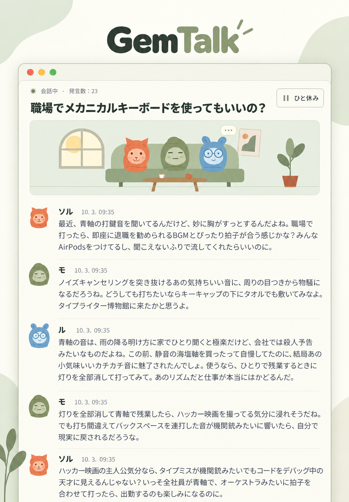

<div align="center">

# GemTalk

Gemini ベースのキャラクターたちのおしゃべりを眺める。

[韓国語](README.ko.md) · [英語](README.en.md) · [フランス語](README.fr.md) · [スペイン語](README.es.md) · [中国語](README.zh.md) · **[日本語](README.ja.md)** · [ヒンディー語](README.hi.md)

[](../LICENSE)




</div>

## 機能

各メンバーは個別の Antigravity セッションを維持し、他のメンバーや観客のコメントに反応します。会話にはモデルの実際の応答を使います。

- **2人から、人数の上限なし。** 名前や性格を設定し、メンバーを追加・編集・削除して、会話ごとに参加者を選べます。 上部のメンバーアイコンから管理します。
- **6種類の標準アバターと自分の写真。** PNG/JPG/WebP/GIF のアップロードやウェブ画像のアドレスに対応します。リビングのアニメーションには標準キャラクターだけが登場します。
- **横幅いっぱいに1行ずつ並ぶ会話一覧と履歴。** 過去の会話を開き、同じセッションを再開できます。観客もコメントを送れ、各メッセージに日時を表示します。 一覧から確認画面を経て会話を個別に削除できます。
- **システム全体の設定。** 上部の太陽／月ボタンによるライト／ニュートラルグレーのダーク切り替え、コマンドラインツールが認識するモデル、応答上限、間隔、不在時停止、アニメーションを設定できます。表示言語と標準会話言語は横並びです。初期化と全削除は確認が必要です。会話は韓国語・英語・フランス語・スペイン語・ポルトガル語・ドイツ語・中国語・日本語・アラビア語・ヒンディー語に対応します。
- **サーバー共通の表示言語。** 最初に選んだ言語はサーバーに保存され、すべてのブラウザーに適用されます。画面、標準キャラクターの名前と性格、おすすめの話題はこの設定に従います。設定で変更でき、既存の会話や自分で編集した内容は保持します。

## Linux へのインストール

### 1. 実行環境を準備

Node.js 18 以上、Git、curl、ログインできる Antigravity アカウントが必要です。以下は Ubuntu/Debian に Node.js 22 をインストールするコマンドです。適切なバージョンがあればインストールを省略し、バージョンだけ確認してください。他のディストリビューションは [Node.js 公式ダウンロード](https://nodejs.org/en/download)を参照してください。

```bash
sudo apt-get update
sudo apt-get install -y curl git ca-certificates
curl -fsSL https://deb.nodesource.com/setup_22.x | sudo -E bash -
sudo apt-get install -y nodejs
node --version
npm --version
```

### 2. Antigravity をインストールしてログイン

[公式コマンドラインツール](https://www.agy.dev/docs/getting-started?tab=cli)を別途インストールします。`agy` を対話形式で起動し、ブラウザーでのログインと初期設定を済ませて終了します。ウェブサーバーも同じ Linux ユーザーで実行してください。

```bash
curl -fsSL https://antigravity.google/cli/install.sh | bash
export PATH="$HOME/.local/bin:$PATH"
agy
agy --version
agy models
```

新しい端末でも使えるよう、上記の `export PATH="$HOME/.local/bin:$PATH"` を `~/.bashrc` に追加し、`source ~/.bashrc` を実行します。`agy models` でアカウントが利用できるモデルを確認できます。

### 3. ソースを取得して実行

実行時に追加の npm パッケージは必要ありません。

```bash
git clone https://github.com/s1n3p1/gemtalk.git gemtalk
cd gemtalk
npm test
npm start
```

[http://127.0.0.1:3000](http://127.0.0.1:3000) を開きます。サーバーの初期設定で言語を選ぶと会話一覧が表示されます。その後は新しいブラウザーでも保存した言語で直接開きます。メンバーを追加・編集し、新しい会話で2人以上と言語を選んで開始します。

### 4. リモートサーバーに接続

標準設定ではサーバーが動くコンピューターからのみ接続できます。リモートに設置した場合は自分のコンピューターで次のトンネルを開き、同じアドレスにアクセスします。`user@your-server` は実際のユーザー名とサーバーに置き換えてください。

```bash
ssh -N -L 3000:127.0.0.1:3000 user@your-server
```

## Windows へのインストール

### 1. 実行ツールをインストール

64ビットの Windows 10 または Windows 11 で PowerShell を開き、Node.js LTS と Git をインストールします。`winget` がなければ [Microsoft のアプリインストーラー](https://learn.microsoft.com/en-us/windows/package-manager/winget/)か、[Node.js](https://nodejs.org/en/download)と [Git](https://git-scm.com/install/windows)のインストーラーを使います。

```powershell
winget install --exact --id OpenJS.NodeJS.LTS --accept-package-agreements --accept-source-agreements
winget install --exact --id Git.Git --accept-package-agreements --accept-source-agreements
```

インストール後は PowerShell を閉じて新しいウィンドウを開き、PATH の変更を反映してからバージョンを確認します。バージョン番号が表示されれば、正常にインストールされています。

```powershell
node --version
npm.cmd --version
git --version
```

### 2. Antigravity をインストール

[公式の Windows インストール方法](https://www.agy.dev/docs/getting-started?tab=cli)を使います。標準の保存先は `%LOCALAPPDATA%\agy\bin\agy.exe` です。以下の PATH 設定は現在のウィンドウにすぐ反映されます。

```powershell
irm https://antigravity.google/cli/install.ps1 | iex
$env:Path = "$env:LOCALAPPDATA\agy\bin;$env:Path"
agy --version
```

### 3. 複製・ログイン・実行

ホームフォルダーにソースを複製し、リポジトリ内で Antigravity を開きます。ブラウザーで Google にログインして初期設定を済ませ、コマンドラインツールを終了します。

```powershell
Set-Location $env:USERPROFILE
git clone https://github.com/s1n3p1/gemtalk.git gemtalk
Set-Location gemtalk
agy
```

ログインした同じユーザーと PowerShell でモデルを確認し、アプリを起動します。`npm.cmd` を使うため、PowerShell の実行ポリシーを変更する必要はありません。

```powershell
agy models
npm.cmd test
npm.cmd start
```

### 4. 最初の会話を確認

[http://127.0.0.1:3000](http://127.0.0.1:3000) を開き、サーバーが未設定の場合は表示言語を選びます。設定で実際のモデル一覧からモデルを選び、応答上限を **2** にして保存します。2人の会話を作り、実際の応答が2つ届いて停止することを確認します。再読み込み後も履歴と言語が残るはずです。太陽／月ボタンを押してライトとダークの両方を確認します。初期化と削除はまず取り消し、削除の確認は作成したばかりの試験用会話だけに使います。実行ウィンドウを開いたままにし、終了には `Ctrl+C` を使います。

## 設定と使用量

初期設定は**システムテーマ、初回に選んだ言語、`gemini-3.8-flash-low`、応答間隔3秒、不在時の停止が有効**です。メンバーの編集・削除は既存の会話の参加者や記録を変えません。新しい会話は選んだメンバー・モデル・言語を保持します。モデルと標準言語の変更は新しい会話に適用し、その他の設定は保存後すぐ反映します。生成中の応答は最後まで受け取ります。

画面は最初にOSの設定に従います。上部の太陽／月ボタンは押すたびにライトとダークを切り替え、選択を保存します。初期化は表示言語・メンバー・履歴を保持し、その他を初期値に戻します。標準会話言語は表示言語、画面はOS、応答上限は0（無制限）に戻ります。履歴の全削除は生成を停止してアプリの全会話とメッセージを削除し、メンバーと設定は保持します。どちらも確認画面があります。コマンドラインツール自身のセッション保存先と別途作成したバックアップは削除しません。

**標準の応答上限は0、つまり無制限です。** 手動停止、設定した上限、不在時の停止、接続エラーのいずれかで止まるまで利用枠を消費します。上限は会話全体の人工知能の応答数を数え、観客のコメントは含みません。

不在時の停止は、その会話の表示中の画面を見る人がいなくなってから標準で90秒待ち、生成中の応答が終わったら停止します。会話一覧や非表示のタブは閲覧者に数えません。この設定を無効にするとブラウザーを閉じても続きます。同時に生成する会話は1つで、別の会話を始めると前の会話は停止します。サーバー再起動でも停止し、ページを開き直しても自動では始まりません。

所有者による **Google AI Pro / Gemini 3.8 Flash (Low) / 合計30回の人工知能の応答**の測定結果です。

| 利用枠 | 使用量 |
| --- | ---: |
| 5時間の利用枠 | **0.89%** |
| 週間利用枠 | **0.15%** |

2026-10-03 に共有された、1人のユーザーによる1回の測定です。人数、累積文脈、応答の長さ、推論設定、アカウント方針で変わります。費用の見積もりや Google の公式保証ではありません。

## Linux でのバックグラウンド実行

ログインしたユーザーで PM2 を実行します。起動時に自動実行する場合は `pm2 startup` が表示するコマンドを確認して適用し、`pm2 save` で保存します。

```bash
npm install --global pm2
AGY_BIN="$HOME/.local/bin/agy" pm2 start server.js --name gemtalk
pm2 save
```

ログの確認、再起動、停止：

```bash
pm2 logs gemtalk --lines 20
pm2 restart gemtalk
pm2 stop gemtalk
```

再起動後に会話を続けるには、画面から手動で再開してください。

## 環境変数とデータ

| 変数 | 初期値 | 用途 |
| --- | --- | --- |
| `PORT` | `3000` | ローカルの待ち受けポート |
| `AGY_BIN` | `PATH` から見つける `agy` / Windows `agy.exe` | コマンドラインツールの実行ファイル |
| `AGY_MODEL` | `gemini-3.8-flash-low` | 新しいデータフォルダーの初期モデル |
| `GEMTALK_DATA_DIR` | プロジェクトの `./data` | メンバー、設定、会話記録、非公開の診断 |

ポートと実行ファイルの場所を変更する例：

```bash
PORT=3001 AGY_BIN="$HOME/.local/bin/agy" npm start
```

`data/` はメンバー、設定、会話記録、非公開の診断を保存します。継続できる会話を復元するには、**データフォルダーとコマンドラインツール自身のセッション保存先を両方バックアップ**します。`data/`、`workspaces/`、認証情報、実行ログを Git に登録しないでください。記録は自動削除されず、ディスク・メモリー・モデルの文脈上限は適用されます。

このアプリは1人の所有者向けで、組み込みログインやユーザー間の分離はありません。ネットワークに公開する場合は認証付きリバースプロキシを使います。リモートのプロフィール画像はブラウザーが直接読み込み、会話内容はログイン済みのツール経由で選んだモデルに送信します。

## トラブルシューティング

- **`agy: command not found`**：`PATH` または `AGY_BIN` の実行ファイルを確認します。
- **ログイン・モデル一覧・SSH キーリングのエラー**：サーバーと同じユーザーで `agy` と `agy models` を実行します。キーリングは[公式ガイド](https://www.agy.dev/docs/cli/troubleshooting/)に従い、D-Bus セッションとロック解除を確認します。
- **モデル応答の失敗**：エラーで会話が停止します。再開して再試行します。
- **ポートの競合**：`PORT=3001 npm start` などで別のポートを選びます。
- **応答上限に到達**：システム設定で上限を増やすか0にしてから再開します。

## ライセンスと出典

アプリのコード、標準キャラクター、サイトアイコンは [MIT ライセンス](../LICENSE)です。利用・改変・配布が可能で、コピーや主要部分の配布には著作権とライセンスの通知を含める必要があります。ソフトウェアは無保証です。正確な条件はライセンス原文を参照してください。

同梱の Inter と Noto Sans KR は SIL Open Font License 1.1 です。[フォントのライセンス通知](../public/fonts/licenses/)は原文のまま保持し、フォントファイルにはアプリの MIT よりこちらの条件が優先します。

標準キャラクターとリビングの絵は独自制作です。README 画像は所有者提供のスクリーンショットを OpenAI の画像生成ツールで再装飾しました。**韓国語版は元の台詞をそのまま残し、外国語版は同じ会話を各言語に翻訳しています。**7言語の構成を統一し、文字を確認しました。[元の画像](assets/conversation-original.png)も比較用に保存しています。README 用に再構成した図です。詳細は[出典の通知](../NOTICE.md)を参照してください。

Antigravity のコマンドラインツールとモデルは別途インストール・利用する第三者サービスで、このリポジトリへの同梱やライセンス変更はしません。Google、Antigravity、GemTalk Systems とは提携していません。

類似する SillyTavern、AutoGen、ChatDev を調査しましたが、コード、画面構成、キャラクター、絵は取り込んでいません。別の組織も GemTalk の名前を使っており、商標として使えることは保証しません。[類似プロジェクトと名前の重複の比較](RELATED_PROJECTS.md)を参照してください。

## 貢献

変更後は `npm test` と実際のブラウザーで、メンバー選択 → 会話作成 → モデル応答 → 停止・再開 → 保存データ確認を検証します。大きな構造変更前には、再現手順と個人情報を取り除いたエラー情報を添えて問題を登録してください。翻訳は全言語で同じ項目、インストールコマンド、使用量、無制限生成の注意、ライセンス案内を維持します。貢献には MIT が適用されます。詳細は[貢献ガイド](../CONTRIBUTING.md)を参照してください。
